# SismoWatch — Plataforma de Monitoreo Sísmico Global en Tiempo Casi Real

> **Autor:** Sebastian Ropain ([@7Freeza](https://github.com/7Freeza))  
> **Repositorio oficial:** [https://github.com/7Freeza/SismoWatch](https://github.com/7Freeza/SismoWatch)  
> **Ruta:** Ingeniería de Datos y Automatización con IA (Apache Airflow · PostgreSQL Medallion · FastAPI · React · Ollama)

---

## Descripción General

**SismoWatch** es una plataforma de ingeniería de datos y automatización con inteligencia artificial que transforma el catálogo público de sismos del **USGS (United States Geological Survey)** en un producto de datos confiable, gobernado, seguro y auditable para los equipos de operaciones y gestión de riesgo.

El sistema extrae de forma automática y repetible el feed GeoJSON de USGS cada 5 minutos mediante **Apache Airflow**, procesa los registros a través de una arquitectura **Medallion (`raw` → `staging` → `curated`)** sobre **PostgreSQL 16** con compuertas bloqueantes de calidad, detecta anomalías estadísticas (`z-score`), redacta reportes ejecutivos diarios validados con **IA local (Ollama `qwen2.5:3b`)** y expone los datos únicamente desde la capa `curated` hacia una plataforma web propia en **FastAPI + React + TypeScript** con transmisión en vivo vía **Server-Sent Events (SSE)**, control de acceso basado en roles (**RBAC**) y un **Agente Conversacional NL-to-SQL** de solo lectura.

---

## Tabla de Contenidos

1. [Propósito y Arquitectura](#1-propósito-y-arquitectura)
2. [Stack Tecnológico](#2-stack-tecnológico)
3. [Estructura del Proyecto](#3-estructura-del-proyecto)
4. [Puesta en Marcha Local](#4-puesta-en-marcha-local)
5. [Orquestación en Apache Airflow e Idempotencia](#5-orquestación-en-apache-airflow-e-idempotencia)
6. [Calidad de Datos](#6-calidad-de-datos)
7. [Seguridad, Roles y Evidencia de Escaneo](#7-seguridad-roles-y-evidencia-de-escaneo)
8. [Automatización con IA y Agente Conversacional NL-a-SQL](#8-automatización-con-ia-y-agente-conversacional-nl-a-sql)
9. [Consumo en Tiempo Real (SSE)](#9-consumo-en-tiempo-real-sse)
10. [Endpoints de la API](#10-endpoints-de-la-api)
11. [Capturas de Pantalla del Sistema en Ejecución](#11-capturas-de-pantalla-del-sistema-en-ejecución)
12. [Pruebas Automatizadas y Verificación](#12-pruebas-automatizadas-y-verificación)
13. [Limitaciones Conocidas y Mejoras para Producción](#13-limitaciones-conocidas-y-mejoras-para-producción)

---

## 1. Propósito y Arquitectura

```text
USGS GeoJSON (all_hour.geojson + fdsnws/event/1/query)
     |
     v  HTTPS + timeout + validación de payload
Airflow: ingest_usgs (cada 5 min) / backfill_usgs (1-60 días)
     |  Guarda payload íntegro en raw.usgs_responses y upsert por id en raw.events
     v  Emite Dataset: sismowatch://raw/events
Airflow: transform_quality (disparado por Dataset)
     |  Tipado, limpieza, sanitización y validación bloqueante por registro
     +--> Válidos -----> staging.events --(Compuerta <= 20% rechazo)--> curated.events (upsert por id)
     +--> Métricas ----> quality.metrics (total, aprobados, rechazados, puntaje, motivos de descarte)
     |
     v
Airflow: daily_ai (diario / bajo demanda admin)
     +--> Anomalías ---> ai.anomalies (z-score horario sobre ventana de 7 días en curated)
     +--> Reporte IA --> ai.reports + ai.runs (cifras SQL + Ollama report_v3 + validador numérico)
     |
     v
FastAPI (Rol BD: api_reader, JWT HS256, RBAC viewer/admin)
     +--> REST API ----> React 18 + Vite + TypeScript + Recharts + Leaflet
     +--> SSE ---------> /api/stream (eventos en vivo sin recargar la página)
     +--> Agente IA ---> /api/ask (Router determinista + NL-to-SQL validado con sqlglot sobre curated)
```

### Decisiones Principales de Arquitectura

- **Arquitectura Medallion (no Lambda):** Se eligió una única ruta **Medallion (`raw` → `staging` → `curated`)** con ingesta micro-batch cada 5 minutos y entrega en tiempo real mediante **SSE** desde `curated`. No se implementó una arquitectura Lambda porque la fuente USGS es un feed HTTP pull actualizado cada minuto; mantener dos rutas de cómputo paralelas (batch y speed layer) con reconciliación agregaría complejidad operativa sin beneficio real de latencia.
- **Separación estricta de capas en PostgreSQL:**
  - `raw`: conserva la respuesta HTTP completa (`raw.usgs_responses`) y el último payload por evento (`raw.events`) para auditoría y reprocesamiento.
  - `staging`: almacena únicamente registros limpios, tipados y validados del lote en curso (`staging.events`).
  - `curated`: única fuente de verdad para consumo analítico, reportes, SSE y agente conversacional (`curated.events`).
  - `quality`, `pipeline`, `ai`, `app`: esquemas dedicados para métricas de calidad, observabilidad de DAGs, reportes/anomalías/auditoría de IA y usuarios autenticados.
- El diseño detallado del modelo de datos, llaves primarias, índices y trade-offs se encuentra en [docs/ARQUITECTURA.md](docs/ARQUITECTURA.md).

---

## 2. Stack Tecnológico

| Componente | Tecnología | Justificación |
| --- | --- | --- |
| **Orquestación** | Apache Airflow 2.10.5 (`LocalExecutor`) | Programación por intervalos, disparo reactivo por `Dataset`, reintentos con backoff exponencial, callbacks y backfill parametrizado. |
| **Base de Datos** | PostgreSQL 16 (`alpine`) | Soporte transaccional para `ON CONFLICT DO UPDATE` (idempotencia), `JSONB` para capa `raw`, roles con privilegios granulares por schema y `pgcrypto`. |
| **Calidad de Datos** | Motor de reglas propio en Python + SQL | Control explícito sobre cada regla y motivo de rechazo sin sobrecarga de dependencias pesadas en el contenedor de Airflow. |
| **IA y Analítica** | Ollama (`qwen2.5:3b`) + `z-score` + `sqlglot` | Ejecución 100 % local sin exponer datos ni incurrir en costos por token, combinada con cálculo estadístico determinista en SQL/Python y validación AST de SQL. |
| **Backend API** | FastAPI + SQLAlchemy + PyJWT + ReportLab | Tipado estricto con Pydantic, inyección de dependencias para RBAC (`viewer`/`admin`), streaming asíncrono SSE y exportación nativa a CSV y PDF. |
| **Frontend Web** | React 18 + TypeScript + Vite + Recharts + Leaflet | Interfaz SPA reactiva con mapas interactivos, series temporales, conexión SSE con reconexión automática y manejo explícito de estados de carga/vacío/error. |
| **Seguridad y Testing** | `bandit` 1.8.0 + `pytest` | Análisis estático de seguridad en Python (SAST) y suite de 44 pruebas automatizadas (14 en Airflow + 30 en API). |

---

## 3. Estructura del Proyecto

```text
.
├── docker-compose.yml             # Orquestación integral de contenedores (Postgres, Airflow, API, Web)
├── .env.example                   # Plantilla de variables de entorno (sin secretos reales)
├── .gitignore                     # Exclusión de .env, artefactos de compilación y cachés
├── README.md                      # Documentación principal y guía de ejecución
├── docs/
│   ├── ARQUITECTURA.md            # Propósito, diagrama, modelo de datos, capas y trade-offs
│   ├── SEGURIDAD.md               # Modelo de privilegios, secretos, RBAC y triage de Bandit
│   ├── EVIDENCIA.md               # Resultados de ejecución real, conteos, pruebas e idempotencia
│   ├── bandit.txt                 # Salida íntegra del escaneo de seguridad con Bandit
│   └── capturas/                  # Evidencia visual de todas las vistas y DAGs en ejecución
├── db/
│   └── init/
│       └── 01_init.sh             # Creación de bases, schemas, tablas, índices, roles y permisos
├── airflow/
│   ├── Dockerfile                 # Imagen de Airflow con dependencias del pipeline
│   ├── requirements.txt           # Librerías de validación, cliente HTTP, SQL y testing
│   ├── dags/                      # ingest_usgs.py, transform_quality.py, backfill_usgs.py, daily_ai.py
│   ├── include/                   # Lógica modular: usgs.py, transform.py, quality.py, ai.py, db.py, prompts/
│   └── tests/                     # Pruebas unitarias de transformación, calidad, IA e integridad de DAGs
├── api/
│   ├── Dockerfile                 # Imagen del backend FastAPI
│   ├── requirements.txt           # Dependencias de API, seguridad, sqlglot, PDF y testing
│   ├── app/                       # Routers, seguridad JWT/RBAC, agente NL-a-SQL, prompts versionados
│   └── tests/                     # Pruebas de endpoints, autenticación 401/403, validador SQL e intenciones
├── web/
│   ├── Dockerfile                 # Construcción multi-stage con Node y servidor Nginx
│   ├── nginx.conf                 # Configuración SPA para React Router
│   └── src/                       # Vistas (Login, Dashboard, Agent, Reports, Pipeline, Admin) y componentes
└── scripts/
    ├── verify.sh                  # Verificación funcional de punta a punta contra contenedores reales
    ├── tests.sh                   # Ejecución de pytest (Airflow + API) y escaneo Bandit
    └── package.sh                 # Empaquetado limpio del proyecto en formato .zip
```

---

## 4. Puesta en Marcha Local

### Requisitos previos

- **Docker** y **Docker Compose v2**.
- *(Opcional)* **Ollama** ejecutándose en el host para generación con LLM local (`qwen2.5:3b`). Si Ollama no está disponible, el sistema opera sin interrupciones mediante su motor de respaldo determinista.

### Paso 1: Configurar variables de entorno

Copia la plantilla `.env.example` a `.env`:

```bash
cp .env.example .env
```

Edita `.env` y define tus contraseñas, `JWT_SECRET` y `AIRFLOW_FERNET_KEY`. Puedes generar una clave Fernet válida con:

```bash
python3 -c "from cryptography.fernet import Fernet; print(Fernet.generate_key().decode())"
```

Variables requeridas en `.env`:

| Variable | Propósito |
| --- | --- |
| `POSTGRES_PASSWORD` | Contraseña del superusuario de inicialización de PostgreSQL |
| `AIRFLOW_DB_PASSWORD` | Contraseña del rol `airflow` para la base de metadatos |
| `INGEST_DB_PASSWORD` | Contraseña del rol `ingest_writer` (solo escritura en `raw`) |
| `TRANSFORM_DB_PASSWORD` | Contraseña del rol `transform_writer` (lectura `raw`, escritura `staging`/`curated`/`quality`/`ai`) |
| `READER_DB_PASSWORD` | Contraseña del rol `api_reader` (solo lectura en `curated` y vistas permitidas) |
| `JWT_SECRET` | Secreto de firma para tokens JWT HS256 |
| `AIRFLOW_FERNET_KEY` | Clave Fernet para cifrado interno de Apache Airflow |
| `AIRFLOW_ADMIN_PASSWORD` | Contraseña del usuario administrador de la interfaz y API de Airflow |
| `ADMIN_EMAIL` / `ADMIN_PASSWORD` | Credenciales sembradas para el rol `admin` en la plataforma SismoWatch |
| `VIEWER_EMAIL` / `VIEWER_PASSWORD` | Credenciales sembradas para el rol `viewer` en la plataforma SismoWatch |
| `OLLAMA_BASE_URL` / `OLLAMA_MODEL` | Endpoint de Ollama (`http://host.docker.internal:11434`) y modelo (`qwen2.5:3b`) |

> El archivo `.env` real **jamás** se sube al repositorio ni se incluye en el empaquetado de entrega.

### Paso 2: Habilitar modelo local en Ollama (opcional)

```bash
ollama serve
ollama pull qwen2.5:3b
```

### Paso 3: Levantar toda la arquitectura con un solo comando

```bash
docker compose up -d --build
docker compose ps
```

### Accesos a los servicios

- **Plataforma Web (React):** `http://localhost:3000`
- **Backend API y documentación OpenAPI (Swagger):** `http://localhost:8000/docs`
- **Apache Airflow UI:** `http://localhost:8080`
- **PostgreSQL 16:** aislado dentro de la red interna de Docker (sin puertos expuestos al host por seguridad).

---

## 5. Orquestación en Apache Airflow e Idempotencia

El sistema cuenta con **4 DAGs** desacoplados que utilizan **TaskFlow API**, `TaskGroup`, `tags`, `doc_md`, `execution_timeout`, `max_active_runs=1`, reintentos con espera exponencial (`retry_exponential_backoff=True`) y callbacks de observabilidad (`on_success_callback` y `on_failure_callback` hacia `pipeline.runs` y webhook opcional):

1. **`ingest_usgs`** (`*/5 * * * *`):
   - Extrae el feed `all_hour.geojson` cada 5 minutos con timeout explícito y validación de estado HTTP y estructura GeoJSON.
   - Registra el payload completo en `raw.usgs_responses` y ejecuta upsert por `id` en `raw.events`.
   - Al finalizar con éxito, emite el Dataset `sismowatch://raw/events`.
2. **`transform_quality`** (disparado por `Dataset("sismowatch://raw/events")`):
   - Se activa automáticamente al concluir `ingest_usgs` o `backfill_usgs`.
   - Limpia, tipa y evalúa las reglas de calidad sobre cada evento.
   - Si la compuerta de calidad aprueba, publica en `curated.events` mediante upsert por `id`.
3. **`backfill_usgs`** (ejecución manual parametrizada):
   - Consulta el endpoint histórico `fdsnws/event/1/query` en bloques de 10 días (parametrizable de 1 a 60 días, por defecto 30 días, y magnitud mínima).
   - Reutiliza el mismo mecanismo idempotente y dispara `transform_quality` al terminar.
4. **`daily_ai`** (`0 6 * * *` y bajo demanda desde Admin):
   - Calcula anomalías sísmicas horarias y genera el reporte ejecutivo diario validado.

### Garantía de Idempotencia

Tanto `raw.events`, `staging.events` como `curated.events` utilizan el identificador oficial del evento de USGS (`id`) como `PRIMARY KEY` con sentencias `INSERT ... ON CONFLICT (id) DO UPDATE`. Si un evento actualiza su magnitud o estado tras ser publicado, o si un DAG/backfill se ejecuta múltiples veces sobre la misma ventana temporal, el registro se actualiza sin generar duplicados (`count(*) == count(DISTINCT id)`).

---

## 6. Calidad de Datos

### Herramienta elegida y justificación

Se implementó un **motor de validación determinista propio en Python y SQL** (`airflow/include/quality.py` y `airflow/include/transform.py`) en lugar de Great Expectations o Pandera para mantener una huella ligera en los contenedores, evitar conflictos de dependencias con Airflow 2.10 y disponer de trazabilidad exacta por regla y por registro.

### Reglas evaluadas por lote y por registro

- **Esquema y tipos esperados:** validación estructural del objeto GeoJSON (`FeatureCollection`, `features`, `properties`, `geometry.coordinates`).
- **Campos obligatorios:** presencia no nula de `id`, `time`, `place`, `longitude`, `latitude`, `depth_km`, `mag` y `event_type`.
- **Rangos geográficos y geofísicos válidos:**
  - Latitud en `[-90, 90]`.
  - Longitud en `[-180, 180]`.
  - Magnitud en `[-1.5, 10.5]`.
  - Profundidad en `[0, 800]` km.
- **Formato y validez temporal:** timestamp epoch convertible a UTC, posterior al año 1900 y sin fechas futuras (tolerancia máxima de 5 minutos).
- **Sanitización de texto:** limpieza de caracteres de control y recorte a 300 caracteres en `place` y `region`.
- **Unicidad de `id`:** deduplicación en memoria por lote y llave primaria con upsert en base de datos.
- **Control de volumen y frescura:** el lote debe contener entre `1` y `20 000` eventos; la plataforma monitorea en tiempo real los segundos transcurridos desde la última compuerta aprobada (`freshness_seconds`).

### Compuerta bloqueante y manejo de rechazos

- **Compuerta bloqueante:** exige al menos 1 registro válido y una tasa de rechazo menor o igual al **20 %** (`score >= 80 %`). Si la compuerta falla, la tarea de Airflow lanza excepción y **`curated.events` no se modifica**.
- **Trazabilidad sin pérdida:** los registros inválidos nunca llegan a `staging` ni a `curated`; su payload íntegro permanece en `raw` para auditoría y `quality.metrics` almacena el total evaluado, aprobados, rechazados, puntaje (`99.5 %` en la corrida de evidencia: `2 001` aprobados y `10` rechazados por `missing_mag` de `2 011` evaluados) y el desglose por regla.
- **Dónde se visualiza:** en las tarjetas KPI del **Dashboard**, en la vista **Estado del Pipeline** (resumen para `viewer`, desglose detallado de reglas y motivos para `admin`) y en el endpoint `/api/pipeline/status`.

---

## 7. Seguridad, Roles y Evidencia de Escaneo

### Gestión de secretos

- Ninguna contraseña, token o clave está escrita en el código fuente ni en el historial de Git.
- Toda credencial se inyecta desde `.env` (ignorado en `.gitignore`), documentado mediante `.env.example`.
- Los usuarios de aplicación (`admin` y `viewer`) se siembran al inicializar PostgreSQL usando variables de entorno y hashing `bcrypt` vía `crypt(..., gen_salt('bf'))` de `pgcrypto`.

### Mínimo privilegio en Base de Datos

| Rol PostgreSQL | Permisos asignados |
| --- | --- |
| `airflow` | Acceso exclusivo a la base de metadatos `airflow`. |
| `ingest_writer` | Solo `SELECT, INSERT, UPDATE` en el schema `raw` de `sismowatch`. |
| `transform_writer` | Solo `SELECT` en `raw`; `SELECT, INSERT, UPDATE, DELETE` en `staging`, `curated`, `quality`, `pipeline` y `ai`. |
| `api_reader` | Solo `SELECT` en `curated.events`, `quality.metrics`, `pipeline.runs`, `ai.reports`, `ai.anomalies`, `ai.runs`, `app.users`, e `INSERT` de auditoría en `ai.query_log`. |

La API de la plataforma conecta **exclusivamente** con el rol `api_reader`: es físicamente imposible que el backend o el agente de IA consulten `raw` o `staging` o modifiquen datos de negocio.

### Modelo de Roles (RBAC) y Autenticación

| Capacidad | Visitante (sin login) | Viewer | Admin |
| --- | :---: | :---: | :---: |
| Ver Dashboard (KPIs, gráficos, mapa) | No (`401`) | Sí | Sí |
| Ver y exportar reportes (CSV / PDF) | No (`401`) | Sí | Sí |
| Ver eventos en tiempo real (SSE) | No (`401`) | Sí | Sí |
| Consultar Agente IA (NL-a-SQL en `curated`) | No (`401`) | Sí | Sí |
| Ver estado del pipeline y calidad | No (`401`) | Sí (resumen) | Sí (detalle de reglas y rechazos) |
| Regenerar reporte IA / Lanzar backfill / Ver auditoría IA | No (`401`) | No (oculto en UI + `403` en API) | Sí |

### Evidencia del escaneo de seguridad (`bandit`)

Se ejecutó **Bandit 1.8.0** sobre todo el código del backend (`api/app`):

```bash
docker compose exec -T api bandit -r app -f txt
```

```text
Total lines of code: 1837
Total lines skipped (#nosec): 0
Run metrics:
  Severity: High: 0 | Medium: 13 | Low: 2
```

- **0 hallazgos de severidad Alta (`High: 0`).**
- Los hallazgos medios (`B608`, confianza baja) corresponden a interpolación controlada de nombres de columna validados contra listas blancas estrictas (`SORT_COLUMNS`) o cláusulas fijas; todos los valores de usuario viajan parametrizados en SQLAlchemy.
- El detalle completo del triage se encuentra en [docs/SEGURIDAD.md](docs/SEGURIDAD.md) y el reporte íntegro en [docs/bandit.txt](docs/bandit.txt).

---

## 8. Automatización con IA y Agente Conversacional NL-a-SQL

### 1. Reporte Ejecutivo Diario (`daily_ai`)

- **Las cifras las calcula SQL/Python, nunca el LLM:** el pipeline consulta `curated.events` y `quality.metrics` para obtener conteos de 24 h vs. 24 h previas, magnitud máxima y promedio, eventos significativos, alertas de tsunami, regiones activas y anomalías.
- **Prompt versionado (`airflow/include/prompts/report_v3.txt`):** instruye a Ollama (`qwen2.5:3b`) a devolver un esquema JSON estructurado (`title`, `summary`, `highlights`) validado con **Pydantic**.
- **Controles anti-alucinación:** el validador verifica que **todo número presente en el texto** coincida exactamente con las métricas calculadas por código y que no existan contradicciones semánticas (por ejemplo, negar eventos significativos cuando sí ocurrieron o invertir la tendencia diaria).
- **Plan alterno (Fallback determinista):** si Ollama excede el timeout, no está disponible o falla la validación numérica, el pipeline no se rompe: publica una plantilla determinista con las cifras exactas y registra el evento en `ai.runs` (modelo, versión de prompt, tokens de entrada/salida, latencia, costo estimado y estado).

### 2. Detección Analítica de Anomalías (`z-score` horario)

- Analiza la serie horaria de los últimos 7 días en `curated.events`, calculando media y desviación estándar por hora.
- Marca una anomalía cuando una ventana horaria registra al menos `5` sismos y un puntaje **`z >= 3.0`**, clasificándola en severidad `baja`, `media` o `alta` y generando una explicación automática con las cifras reales en `ai.anomalies`.

### 3. Bono: Agente Conversacional NL-a-SQL (`/api/ask`)

- **Router determinista de intenciones (`api/app/intents.py`):** saludos, despedidas, agradecimientos, preguntas de identidad/capacidades o entradas fuera de dominio responden en milisegundos sin invocar a Ollama ni ejecutar SQL.
- **Generación y validación estricta de SQL (`api/app/nl_agent.py`):** combina plantillas SQL parametrizadas para consultas frecuentes con generación abierta mediante Ollama (`nl_sql_v2.txt`). Todo SQL es analizado sintácticamente con **`sqlglot`**, exigiendo una única sentencia `SELECT` exclusivamente sobre `curated.events`, bloqueando cualquier `INSERT/UPDATE/DELETE/DROP` o acceso a otros schemas, aplicando `LIMIT <= 200`, `statement_timeout = 5000ms` y transacción `READ ONLY` bajo el rol `api_reader`.
- **Respuesta natural validada (`answer_v1.txt`):** redacta la respuesta en lenguaje natural validando cifras y ubicaciones contra las filas reales retornadas, mostrando debajo la tabla de resultados y el SQL ejecutado como evidencia.

---

## 9. Consumo en Tiempo Real (SSE)

La plataforma implementa **Server-Sent Events (SSE)** en el endpoint `GET /api/stream`:

- **Por qué SSE en lugar de WebSocket o Polling tradicional:** el flujo de eventos sísmicos hacia el navegador es estrictamente **unidireccional** (servidor → cliente). SSE opera sobre HTTP estándar, consume menos recursos que mantener sockets bidireccionales abiertos, envía *heartbeats* periódicos y aprovecha la reconexión automática nativa de la API `EventSource` del navegador ante cualquier corte de red.
- **Indicador en interfaz:** la barra superior del Dashboard muestra el estado **`EN VIVO`** junto con la marca de tiempo de la última actualización, inyectando los nuevos sismos al instante sin recargar la página.

---

## 10. Endpoints de la API

| Método | Ruta | Rol requerido | Descripción |
| --- | --- | --- | --- |
| `POST` | `/auth/login` | Público | Autenticación de usuario y emisión de token JWT HS256 |
| `GET` | `/api/health` | Público | Verificación de salud del backend y conexión a PostgreSQL |
| `GET` | `/api/kpis` | `viewer`, `admin` | Indicadores clave (24h, magnitud máx/prom, tsunami, calidad, frescura) |
| `GET` | `/api/events` | `viewer`, `admin` | Listado paginado de sismos con filtros por fecha, magnitud y región |
| `GET` | `/api/stats/timeseries` | `viewer`, `admin` | Serie temporal horaria de eventos y magnitud máxima |
| `GET` | `/api/stats/magnitude` | `viewer`, `admin` | Distribución de eventos por rangos de magnitud |
| `GET` | `/api/stats/regions` | `viewer`, `admin` | Regiones con mayor actividad sísmica |
| `GET` | `/api/stream` | `viewer`, `admin` | Canal en tiempo real mediante Server-Sent Events (SSE) |
| `GET` | `/api/reports` | `viewer`, `admin` | Historial paginado de reportes ejecutivos generados con IA |
| `GET` | `/api/reports/export` | `viewer`, `admin` | Exportación descargable de reportes en formato `CSV` o `PDF` |
| `GET` | `/api/pipeline/status` | `viewer`, `admin` | Estado de los 4 DAGs, compuerta de calidad, frescura y anomalías |
| `POST` | `/api/ask` | `viewer`, `admin` | Agente conversacional NL-a-SQL de solo lectura sobre `curated` |
| `POST` | `/api/admin/backfill` | `admin` | Dispara el DAG `backfill_usgs` parametrizado (1 a 60 días) |
| `POST` | `/api/admin/reports/regenerate` | `admin` | Dispara el DAG `daily_ai` para recalcular anomalías y reporte IA |
| `GET` | `/api/admin/ai-runs` | `admin` | Auditoría detallada de ejecuciones del modelo (tokens, latencia, estado) |

---

## 11. Capturas de Pantalla del Sistema en Ejecución

### Inicio de Sesión y Control de Acceso
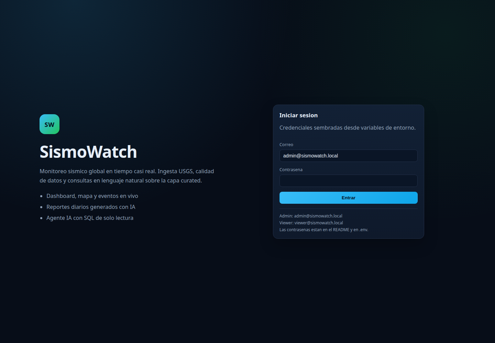

### Dashboard Sísmico Global en Tiempo Real (KPIs, Series, Distribución y Mapa)
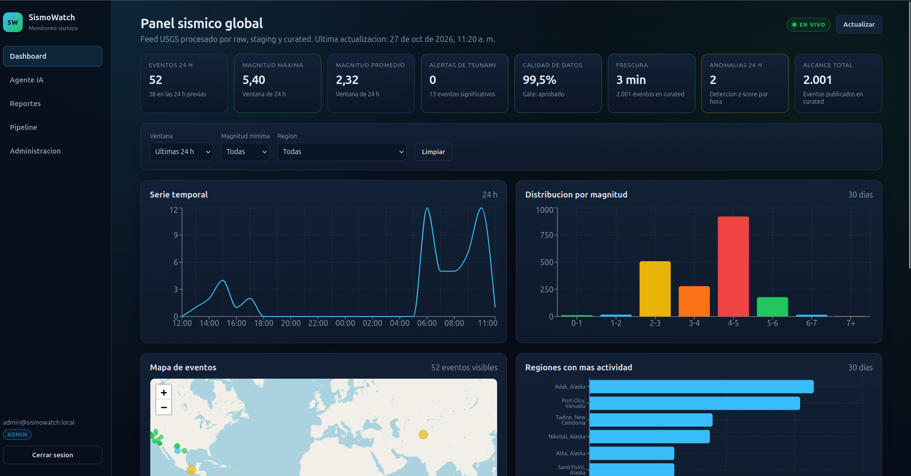

### Vista Completa del Dashboard con Mapa Interactivo y Stream de Eventos en Vivo
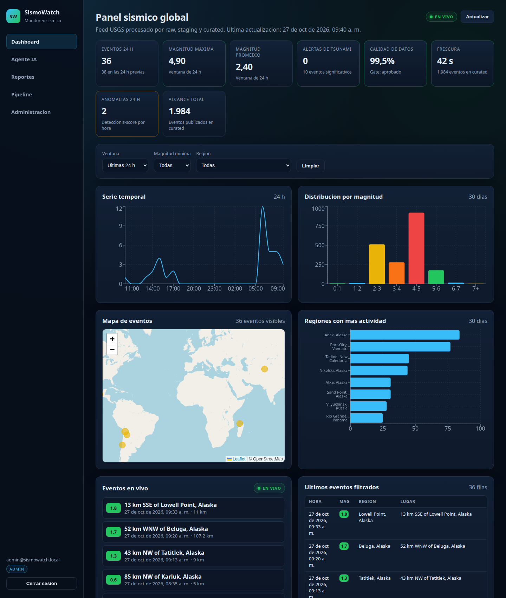

### Reportes Ejecutivos Generados con IA (Ollama `qwen2.5:3b` con Cifras Validadas)
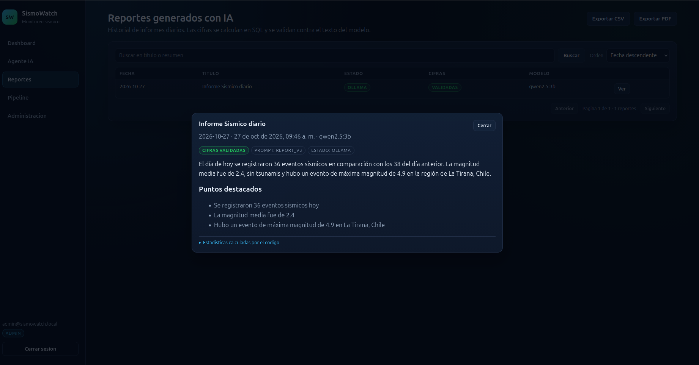

### Agente Conversacional IA — Saludo Determinista (Sin Consumo de LLM ni SQL)
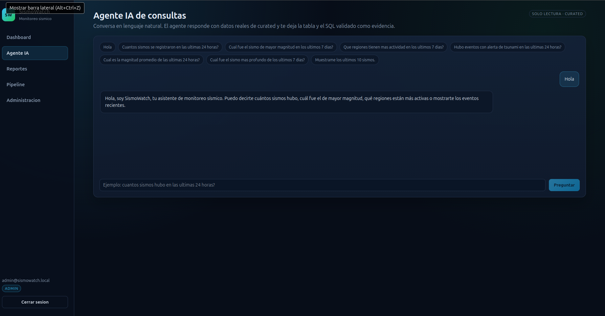

### Agente Conversacional IA — Consulta en Lenguaje Natural a SQL Validado (Últimas 24h)
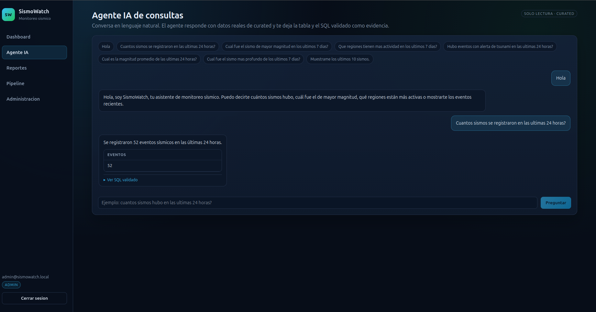

### Agente Conversacional IA — Consulta del Sismo de Mayor Magnitud y Últimos 3 Eventos
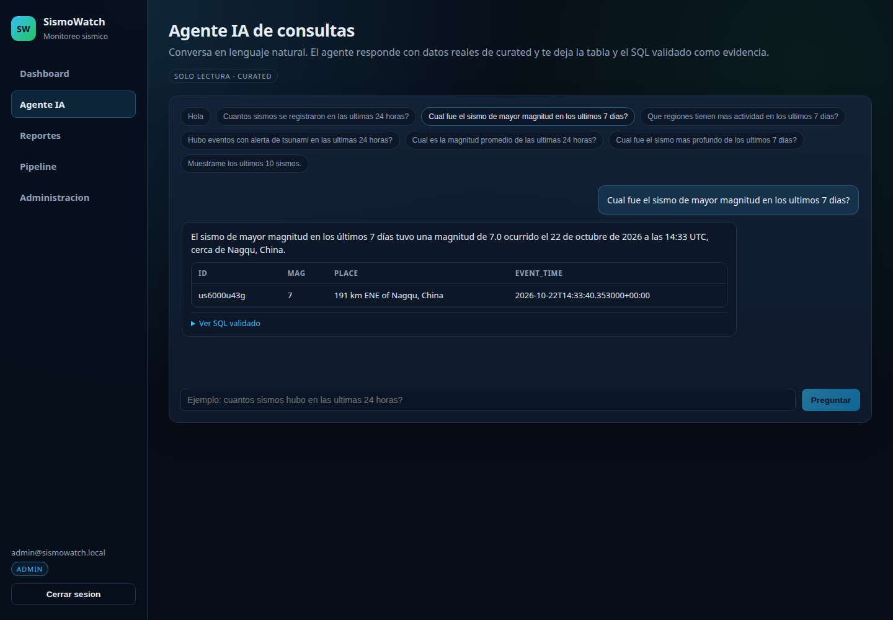
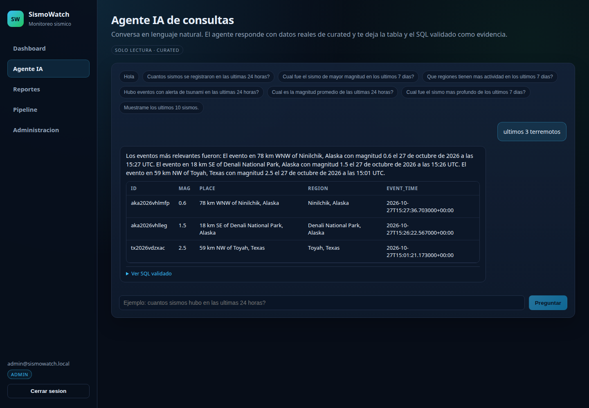

### Estado del Pipeline, Compuerta de Calidad y Detección de Anomalías (`z-score`)
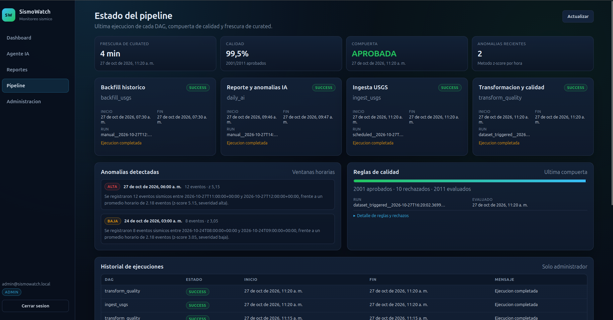

### Panel de Administración (Backfill Histórico, Regeneración y Auditoría de IA)
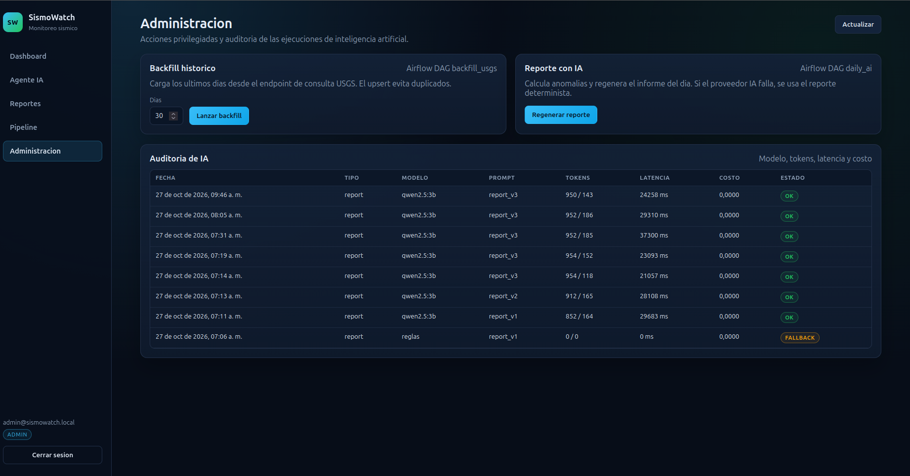

### Apache Airflow — Los 4 DAGs Activos y Ejecutados Sin Errores
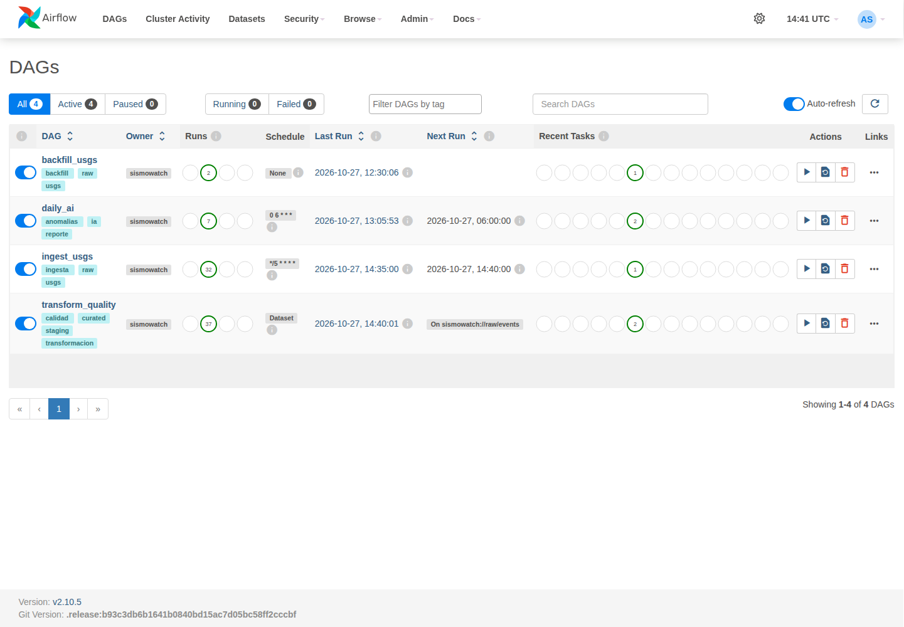

---

## 12. Pruebas Automatizadas y Verificación

Para ejecutar la suite completa de pruebas unitarias e integrales (`pytest` en Airflow y en FastAPI) junto con el escaneo de seguridad `bandit`:

```bash
bash scripts/tests.sh
```

O de manera individual:

```bash
# Pruebas de transformación, calidad, validación IA e integridad de DAGs (14 tests)
docker compose exec airflow-scheduler bash -lc \
  "cd /opt/airflow && PYTHONPATH=/opt/airflow:/opt/airflow/include pytest -q tests"

# Pruebas de endpoints, RBAC 401/403, agente NL-a-SQL e intenciones (30 tests)
docker compose exec api pytest -q tests
```

Para ejecutar la verificación funcional reproducible de punta a punta contra los servicios activos:

```bash
bash scripts/verify.sh
```

El detalle completo de los resultados de ejecución se encuentra en [docs/EVIDENCIA.md](docs/EVIDENCIA.md).

---

## 13. Limitaciones Conocidas y Mejoras para Producción

1. **Autenticación en el canal SSE:** Dado que el estándar `EventSource` de los navegadores no permite enviar cabeceras `Authorization: Bearer`, el token viaja como query param en `/api/stream` y Uvicorn se ejecuta con `--no-access-log` para no exponerlo en logs. En producción se reemplazaría por cookies `HttpOnly; Secure; SameSite=Strict` o tickets efímeros de un solo uso.
2. **Escalabilidad de base de datos y ejecutor de Airflow:** En este entorno local, la base de metadatos de Airflow y la base analítica `sismowatch` residen en la misma instancia de PostgreSQL 16 y Airflow utiliza `LocalExecutor`. En producción se separarían en instancias independientes con réplicas de lectura, backups automatizados, particionado temporal en `curated.events` y `CeleryExecutor` o `KubernetesExecutor`.
3. **Capacidad del modelo LLM local:** El modelo ligero `qwen2.5:3b` permite ejecución local sin GPU dedicada ni costos por API, pero ocasionalmente puede fallar en comparaciones complejas; el validador determinista de cifras y contradicciones intercepta cualquier desvío y garantiza que nunca se publique un dato falso.
4. **Gestión de secretos y CI/CD:** En un despliegue productivo, `.env` se sustituiría por un gestor de secretos centralizado (AWS Secrets Manager o HashiCorp Vault) e integración continua con `gitleaks`, `pip-audit` y `bandit` en cada Pull Request.
