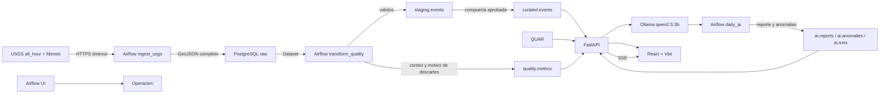

# Arquitectura SismoWatch

## 1. Proposito

SismoWatch convierte el feed publico de terremotos de USGS en un producto de datos confiable para
operaciones y gestion de riesgo. Responde cuatro preguntas: que ocurrio, donde, cuando y con que
magnitud. Habilita decisiones de priorizacion, seguimiento de actividad por region, deteccion de
picos anormales y consultas ad hoc en lenguaje natural.

Usuarios:

- Viewer: consulta dashboard, mapa, eventos, reportes, pipeline y agente. No administra.
- Admin: ademas lanza backfill, regenera reportes con IA y audita las ejecuciones del modelo.
- Visitante sin sesion: no accede a ningun dato.

## 2. Diagrama de componentes

## 3. Capas de datos

| Capa | Schema | Contenido | Consumidor |
| --- | --- | --- | --- |
| Raw | `raw` | Respuesta USGS sin transformar y eventos por id | Airflow transformacion |
| Staging | `staging` | Eventos tipados, limpios y validados | Airflow publicacion |
| Curated | `curated` | Eventos listos para consumo, upsert por id | API y agente |
| Calidad | `quality` | Metricas y motivos de descarte por ejecucion | API y dashboard |
| Operacion | `pipeline` | Estado de DAGs y mensajes de fallo | API pipeline |
| IA | `ai` | Reportes, anomalias, auditoria de runs y consultas | API y frontend |
| Aplicacion | `app` | Usuarios y hashes bcrypt | Login |

La API nunca consulta `raw` ni `staging`. El rol `api_reader` tiene `USAGE` solo en los schemas
permitidos y `SELECT` solo en tablas de consumo. La API no accede a raw ni a staging.

## 4. Modelo de datos

### raw

- `raw.usgs_responses(id bigserial pk, endpoint, fetched_at, http_status, feature_count, payload jsonb)`
- `raw.events(id text pk, payload jsonb, first_seen_at, last_seen_at, last_response_id fk)`
- Indice por `last_seen_at`. El upsert actualiza `payload`, `last_seen_at` y la respuesta asociada.

### staging y curated

- `staging.events(id text pk, mag, place, region, event_time, updated_time, tsunami, significance,
  status, mag_type, event_type, url, longitude, latitude, depth_km, hour_bucket, staged_at)`
- `curated.events(id text pk, mag numeric(4,2), place, region, event_time, updated_time, tsunami,
  significance, status, mag_type, event_type, url, longitude numeric(8,5), latitude numeric(7,5),
  depth_km numeric(6,2), hour_bucket, significant, curated_at, updated_at)`
- Indices por `event_time`, `mag`, `region` y `hour_bucket`.
- `significant` es verdadero si `mag >= 4.5`, hay tsunami o `significance >= 600`.
- La clave primaria `id` garantiza que dos ejecuciones del mismo intervalo no dupliquen.

### calidad y operacion

- `quality.metrics(id bigserial pk, dag_run_id, checked_at, total, passed, rejected, score,
  gate_passed, rules jsonb, details jsonb)`
- `pipeline.runs(id bigserial pk, dag_id, run_id, status, started_at, finished_at, message, details jsonb)`

### IA

- `ai.reports(id bigserial pk, report_date unique, title, summary, highlights jsonb, statistics jsonb,
  model, prompt_version, status, numbers_valid, generated_at)`
- `ai.anomalies(id bigserial pk, detected_at, window_start, window_end, method, score, event_count,
  expected, severity, explanation, unique(window_start, method))`
- `ai.runs(id bigserial pk, kind, model, prompt_version, tokens_in, tokens_out, latency_ms,
  cost_estimate, success, error, created_at)`
- `ai.query_log(id bigserial pk, question, sql, provider, success, latency_ms, created_at)`

### aplicacion

- `app.users(id bigserial pk, email unique, password_hash, role check(viewer, admin), created_at)`
- Los usuarios se siembran desde variables de entorno con `crypt()` de pgcrypto.

## 5. Decision: Medallion

Se eligio Medallion porque el enunciado exige schemas raw, staging y curated y porque la fuente es
un feed pull basado en HTTP que se puede procesar en micro-lotes de cinco minutos. No existe una
necesidad real de una speed layer separada: la latencia objetivo se cumple con la ingesta frecuente
y SSE sobre curated.

No es Lambda: no existen dos rutas de computo (batch y speed) ni reconciliacion entre ambas. Si se
la llama hibrida es solo porque la ingesta es micro-batch y el consumo es en tiempo real; el
procesamiento sigue siendo una sola ruta Medallion. Lambda habria agregado complejidad sin mejorar
el caso. La arquitectura se mantiene:

- Raw conserva el dato original para auditoria y reproceso.
- Staging concentra tipado y limpieza.
- Curated es la unica capa que ve la plataforma.
- La calidad es una compuerta, no un reporte posterior.

## 6. Orquestacion con Airflow

### ingest_usgs

- Schedule `*/5 * * * *`, `catchup=False`, `max_active_runs=1`.
- Reintentos 3 con espera creciente, `execution_timeout` de 8 minutos.
- Timeout HTTP, validacion de estado y de GeoJSON.
- Guarda la respuesta completa y hace upsert por id.
- Emite el Dataset `sismowatch://raw/events` solo si la ingesta fue exitosa.

### transform_quality

- Se dispara por Dataset, no por cron.
- Lee raw, mapea GeoJSON, valida y escribe staging solo con los registros aprobados.
- Guarda metricas de la ejecucion.
- Si la compuerta falla, lanza excepcion y no publica en curated.
- La publicacion es un task separado para que la trazabilidad quede visible en Airflow.

### backfill_usgs

- DAG manual parametrizado con `days` (1-60) y `minmagnitude`.
- Consulta `fdsnws` en bloques de 10 dias.
- Usa el mismo upsert que la ingesta; repetir el backfill no duplica.
- Al terminar emite el Dataset y dispara la transformacion.

### daily_ai

- Schedule diario a las 06:00 UTC.
- Detecta anomalias horarias y genera el reporte.
- Se puede disparar desde el panel admin mediante la API REST de Airflow.

### Callbacks y observabilidad

- `on_success_callback` y `on_failure_callback` escriben en `pipeline.runs`.
- La misma callback envia un webhook si `ALERT_WEBHOOK_URL` esta definido.
- La UI muestra ultima ejecucion, estado, mensaje, calidad y frescura.

## 7. Calidad de datos

Reglas bloqueantes por registro:

- Esquema y tipos esperados.
- Campos obligatorios: id, time, place, coordenadas, profundidad, magnitud y tipo.
- Latitud [-90, 90] y longitud [-180, 180].
- Magnitud [-1.5, 10.5] y profundidad [0, 800] km.
- Fecha valida, no futura y posterior a 1900.
- Texto saneado, sin caracteres de control y maximo 300 caracteres.
- Unicidad por id mediante clave primaria y upsert.
- Volumen del lote entre 1 y 20 000 registros.

Compuerta:

- Puntaje = aprobados / total * 100.
- Rechazo maximo 20 %.
- Al menos un registro aprobado.
- Si falla, curated no cambia y la ejecucion falla.

Los rechazados no se cargan en staging ni en curated. Su payload original permanece en raw para
auditoria, y `quality.metrics` guarda total, aprobados, rechazados, puntaje, reglas y conteo de
motivos. La plataforma muestra el resumen a viewer y el detalle de reglas a admin.

## 8. Seguridad

- Secretos solo en `.env`, fuera de Git. `.env.example` documenta las variables.
- Base de datos con roles separados:
  - `ingest_writer`: raw.
  - `transform_writer`: raw de lectura, staging, curated, calidad, pipeline e IA.
  - `api_reader`: curated, metricas, pipeline, reportes, anomalias, usuarios y log de consultas.
  - `airflow`: metadata de Airflow en otra base.
- JWT HS256 con expiracion configurable.
- Roles viewer/admin validados en backend; la UI oculta admin, pero el endpoint tambien rechaza.
- CORS restringido a `WEB_ORIGIN`.
- Consultas SQL parametrizadas en la API.
- Datos externos tratados como no confiables: HTTPS, timeout, validacion de payload y saneamiento
  de `place` antes de usarlo o enviarlo al modelo.
- El agente NL no ejecuta DDL/DML y usa una transaccion de solo lectura con timeout.
- Logs sin tokens ni contrasenas. Uvicorn corre con `--no-access-log` para no registrar el token
  SSE que viaja en el query string.
- El viewer recibe solo el resumen de calidad; `rules` y `details` se eliminan de la respuesta y se
  reservan al admin.

## 9. Automatizacion con IA

### Reporte narrativo

- Las cifras se calculan en SQL: eventos, maximos, promedio, tsunami, significativos, regiones,
  calidad y anomalias.
- El prompt versionado `report_v3` recibe solo ese JSON.
- La salida se valida con Pydantic: `title`, `summary`, `highlights`.
- Se valida que todo numero del texto exista en las estadisticas.
- Se validan contradicciones: no negar eventos significativos/tsunami/anomalias existentes y no
  invertir la comparacion con las 24 horas previas.
- Si algo falla, se publica el reporte determinista y se registra el motivo.
- Cada ejecucion se registra en `ai.runs` con modelo, prompt, tokens, latencia, costo y error.

### Anomalias

- Serie horaria de los ultimos 7 dias en curated.
- z-score por hora con media y desviacion estandar.
- Se marca una anomalia si hay al menos 5 eventos y z >= 3.
- Severidad baja, media o alta.
- Explicacion generada con las cifras reales y upsert por ventana y metodo.

### Agente de lenguaje natural

El agente separa conversacion, SQL y redaccion para evitar que un saludo consuma el modelo y para
que la tabla nunca sea la respuesta principal.

Intenciones conversacionales:

- Saludos, agradecimientos, despedidas, identidad, capacidades, groserias y mensajes sin sentido
  pasan por un clasificador determinista en `intents.py`.
- No llaman a Ollama ni a SQL; responden con plantillas de personalidad en milisegundos.
- No se usa RAG para esto: RAG aplica a documentos; un router de intenciones es mas barato y no
  alucina.

Capa SQL:

- Las intenciones conocidas usan SQL determinista y parametrizado por reglas: conteo, maximo,
  promedio, regiones, tsunami, profundidad, significativos, ubicacion y eventos recientes. Los
  limites solicitados ("ultimos 3") se respetan y se acotan entre 1 y 50.
- Las consultas abiertas usan Ollama con el prompt `nl_sql_v2`, que incluye el historial reciente.
- sqlglot parsea el SQL y exige una sola sentencia SELECT, tablas de `curated.events` o CTE sobre
  esa tabla, sin DDL/DML ni otros schemas, y un limite maximo de 200 filas.
- Se ejecuta con `api_reader`, `statement_timeout` de 5 segundos y transaccion read-only.

Capa de respuesta:

- El prompt `answer_v1` define la personalidad de SismoWatch y prohibe inventar datos.
- Ollama redacta una a tres frases usando solo la pregunta, el historial y las filas.
- Se valida que los numeros existan en las filas o en la pregunta, que los lugares mencionados
  existan en `place`/`region`, que los valores obligatorios aparezcan y que no se nieguen datos
  existentes.
- Si la validacion falla, se usa una respuesta determinista construida con los campos clave.
- La tabla y el SQL se muestran debajo como evidencia; el texto es la respuesta.
- El historial de seis mensajes permite resolver seguimientos.

Cada consulta se audita en `ai.query_log`.

## 10. Tiempo real

Se usa Server-Sent Events en `/api/stream`. El backend consulta curated cada 5 segundos y envia
eventos nuevos, con heartbeat y reconexion automatica del navegador. Se prefirio SSE a WebSocket
porque el flujo es unidireccional, permite reconexion nativa y reduce complejidad. El token viaja
como query param porque `EventSource` no admite cabeceras; es una limitacion consciente para el
alcance del examen.

## 11. Trade-offs

- Airflow en lugar de cron: costo operativo mayor, pero reintentos, dependencias, backfill,
  observabilidad y Dataset justifican la eleccion.
- PostgreSQL en lugar de un warehouse: suficiente para el volumen del feed, simplifica el
  despliegue y permite separar schemas y roles. En produccion se evaluaria una capa columnar.
- Validaciones propias en Python en lugar de Great Expectations o Pandera: menor dependencia y
  control total del mensaje de rechazo. Se pierde el ecosistema de expectativas reutilizables.
- LocalExecutor: menos contenedores y memoria, pero no escala a muchos workers. En produccion se
  usaria Celery o Kubernetes.
- Ollama local: sin costo por token y sin enviar datos a terceros, pero con menor calidad que un
  modelo grande. El fallback determinista protege la entrega.
- SSE en lugar de WebSocket: mas simple para un flujo de solo servidor a cliente.

## 12. Que cambiaria en produccion

- Separar la metadata de Airflow de la base analitica.
- Backups, replicas y monitoreo de PostgreSQL.
- Secret backend (Vault, AWS Secrets Manager) en lugar de `.env`.
- Alertas reales a Slack/Telegram y SLOs de frescura.
- Modelo LLM con evaluacion offline y prompts con pruebas de regresion.
- Autenticacion con refresh tokens y cookie HttpOnly para SSE.
- Pruebas de carga del feed y del SSE.
- Imagenes fijadas por digest, escaneo de vulnerabilidades en CI y politicas de red.
